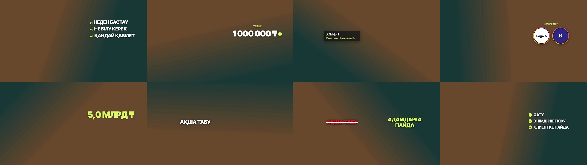

# talking-head-motion

**Камераға сөйлейтін видеоға сөзге синхрон мәтін анимациясы + binaural immersive дыбыс — Claude Code скилі.**
*A Claude Code skill that adds speech-synced kinetic text and binaural "Atmos-like" SFX to talking-head videos, rendered in code with Remotion.*

Видеоны бересіз → жергілікті Whisper сөздерді уақытымен шығарады → Claude айтылған сандарды, тізімдерді, есімдерді, компанияларды, қарама-қарсылықтарды тауып storyboard жасайды → бір `timeline.json` файлынан әрі анимация (Remotion, 60 fps), әрі әр анимацияға өз дыбысы (binaural, басты айнала естіледі) құрылады.



## Не істейді

| Сөйлеуде | Экранда | Дыбыс |
|---|---|---|
| «500 мыңнан миллион теңгеге дейін» | санауыш 500 000 → 1 000 000 ₸+ | whoosh + тықыл + шыңғыр |
| Видеодағы ең күшті сан | санауыш + бетке punch-in | басты айналатын riser → impact + sub |
| «Бірінші… екінші… үшінші…» | жинақталатын нөмірлі тізім | беттен элементке ұшатын swish |
| Есім, лауазым | есім тақтасы | whoosh |
| Компания атаулары | логотиптер «сплывать» | pop (сол/оң) |
| «Ақша табу емес — адамдарға пайда» | қызыл, сызылған сөз ↔ акцент сөз | glitch + swish |
| Жиі жауаптар → «бұл дұрыс» | тізім + ✓ stagger | өрлейтін шыңғырлар |
| «Видеоны тоқтатыңыз» / кідіріс | ⏸, 5 → 1 кері санақ | power-down, тик-так + аккорд |
| CTA | YouTube «Жазылу» + курсор | click + bell |

Барлық дыбыс — numpy-мен синтез (sample, лицензия жоқ). Қазақ әріптері мен ₸ таңбасы бар шрифт (Inter Tight, OFL) ішінде.

## Тез бастау

Claude Code-қа [PROMPT.md](PROMPT.md)-дағы промптты беріңіз — қалғанын скилл өзі жасайды. Қолмен:

```bash
git clone https://github.com/shalabaymaksat/talking-head-motion && cd talking-head-motion
(cd template && npm i) && pip install -r requirements.txt

scripts/prepare.sh ~/video.mov                      # прокси + дауыс + ұзақтық
python3 scripts/transcribe.py work/voice_stt.wav --lang kk   # жергілікті Whisper large-v3
# → template/src/timeline.json жазыңыз (не Claude жазады), ұзақтықты "duration"-ға
(cd template && npx remotion studio)               # браузерде алдын ала көру
(cd template && npx remotion render Main out/video_noaudio.mp4 --muted)
scripts/finish.sh out/final.mp4                     # binaural SFX + микс + дайын MP4
```

Өз видеоңыз жоқ болса: `scripts/demo_video.sh && scripts/prepare.sh work/demo.mp4` — мысал timeline.json 30 с тест видеоға дайын.

## Талаптар
- Node 18+, Python 3.9+, ffmpeg (PATH-та не `FFMPEG=` айнымалысы)
- Whisper: Apple Silicon — `mlx-whisper`; Linux/Windows/Intel — `faster-whisper`. Модель (large-v3, ~3 ГБ) бірінші іске қосқанда жүктеледі, кейін офлайн.
- API кілт керек емес.

## Құрылым
```
SKILL.md                 Claude-қа нұсқаулық (пайплайн, ережелер, белгілі ақаулар)
PROMPT.md                көшіріп қолданатын промпттар
references/              мәтін анимациясы ережелері, storyboard үлгісі
scripts/                 prepare, transcribe (Whisper), immersive (binaural), finish, logo_cutout
template/                Remotion жобасы: timeline.json + 12 элемент типі + камера
```

## Immersive дыбыс туралы
`scripts/immersive.py` шынайы Dolby Atmos емес (ол объектілік формат, Dolby энкодерін керек етеді). Оның құлаққаптағы әсерін binaural стереомен береді: құлақаралық кідіріс (ITD), бас көлеңкесі (ILD), қозғалмалы көздер, синтезделген бөлме реверберациясы, sub-қабат, дауыс кезінде фонды басу. Құлаққаппен тыңдаңыз.

## Лицензия
MIT — [LICENSE](LICENSE). Шрифт Inter Tight — SIL OFL 1.1.
Авторы: Максат Шалабай. Моушн ережелері `launch-motion` скилінің принциптеріне негізделген.
